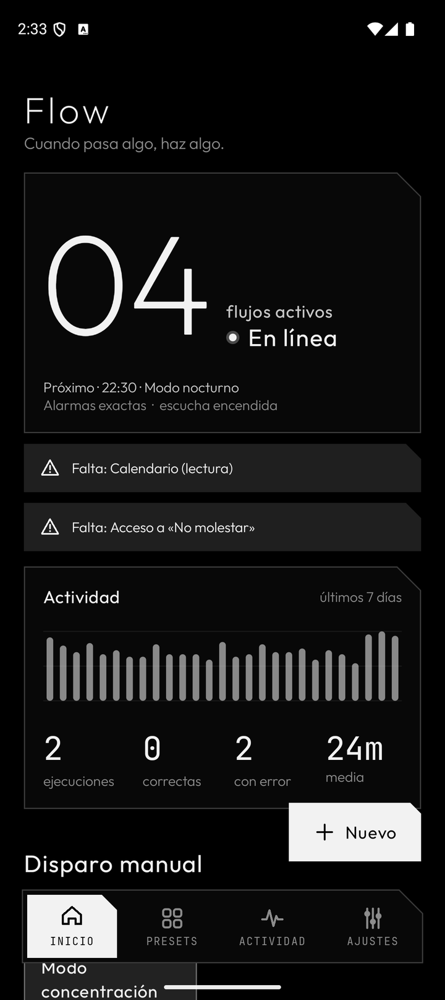
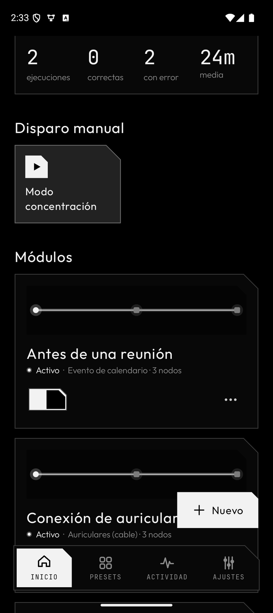
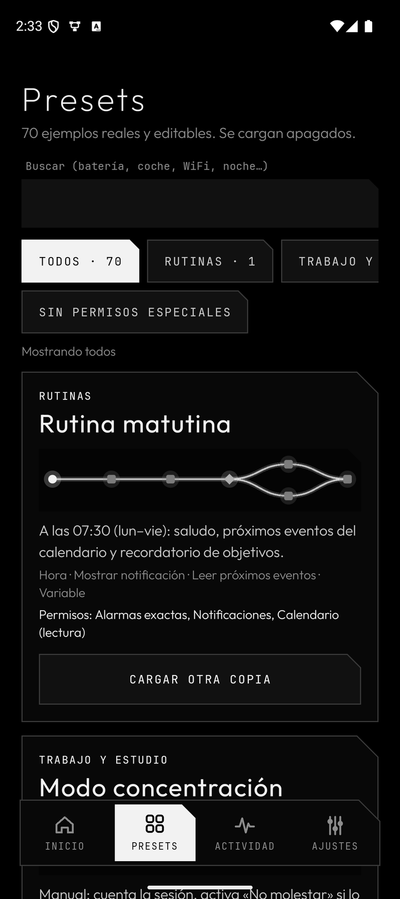
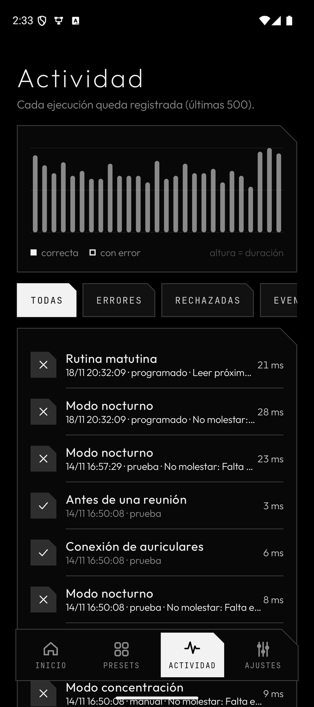
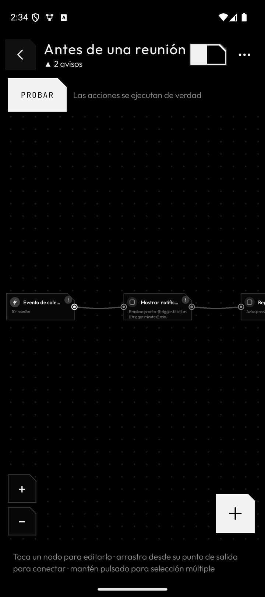
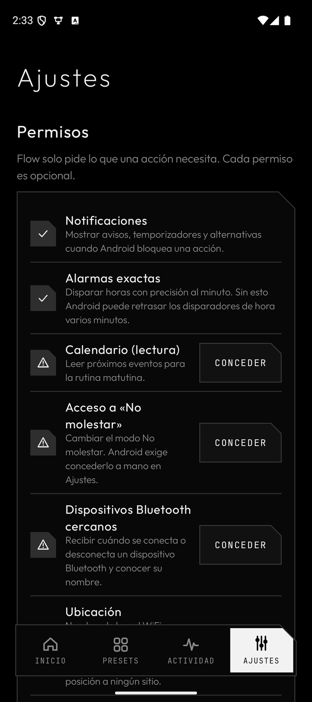

# FLOW

Automatización visual personal para Android: construyes tus propios flujos **CUANDO** (disparador) / **SI** (condición) / **ENTONCES** (acción) en un lienzo de nodos. Todo se ejecuta en el dispositivo; la app no declara el permiso `INTERNET`.

| Inicio | Flujos | Presets |
|---|---|---|
|  |  |  |

| Actividad | Editor de lienzo | Ajustes y permisos |
|---|---|---|
|  |  |  |

Capturas reales (`adb screencap`) de la app release corriendo en un emulador Pixel_API36 (Android 16) con flujos y registros de ejemplo creados con las plantillas de la propia app; no contienen datos personales.

## Características

- **Editor de lienzo** con nodos de disparador, condición y acción, conexiones por arrastre, selección múltiple, zoom, prueba del flujo y validación con avisos.
- **70 presets** en 10 categorías (sueño y noche, trabajo y estudio, coche, batería, auriculares y Bluetooth, casa y WiFi, ubicación y horarios, privacidad, pantalla y sonido, rutinas), con búsqueda, filtro «sin permisos especiales» y paginación. Se cargan apagados y son editables. Se definen en `app/.../ui/Templates.kt` y `PresetsExtra.kt`.
- **Motor** en Kotlin puro (`:engine`): modelo, ejecución, validador, planificación y exportación versionada de flujos.
- **Disparadores y acciones de Android**: alarmas exactas, calendario, batería y carga, WiFi, auriculares, Bluetooth, ubicación, notificaciones y más, con receptores y WorkManager.
- **Actividad**: cada ejecución queda registrada (últimas 500) con filtros por errores y rechazadas.
- Los estados se leen por glifo y texto, no solo por color.

## Instalación

Descarga `flow-0.1.0.apk` de la [última release](../../releases/latest) y comprueba el `sha256` publicado junto a él:

```
sha256sum -c flow-0.1.0.apk.sha256
adb install -r flow-0.1.0.apk
```

> **Aviso:** el APK está **firmado con la clave de depuración** de Android (el módulo `app` no define firma de release; el APK `release` compilado se firmó con `apksigner` y esa clave). Sirve para probar la app; no es una firma de producción, no pasa por Play Store ni Play Protect y Android puede avisar al instalarlo. Requiere Android 8.0 (API 26) o superior.

## Permisos

Todos son opcionales y se piden solo cuando una acción los necesita (detalle y revisión en [docs/SEGURIDAD.md](docs/SEGURIDAD.md)).

| Permiso | Para qué |
|---|---|
| `POST_NOTIFICATIONS` | Avisos, temporizadores y alternativa cuando Android bloquea abrir una app |
| `SCHEDULE_EXACT_ALARM` | Disparadores de hora precisos (sin él se degrada a alarma aproximada) |
| `RECEIVE_BOOT_COMPLETED` | Reprogramar alarmas y escuchas tras reiniciar |
| `FOREGROUND_SERVICE`, `FOREGROUND_SERVICE_SPECIAL_USE` | Escucha de batería, carga, WiFi y auriculares con cable, solo con flujos activos que la necesiten |
| `READ_CALENDAR` | Acción «Leer próximos eventos» y disparador de calendario |
| `BLUETOOTH_CONNECT` | Nombre del dispositivo Bluetooth |
| `ACCESS_FINE_LOCATION`, `ACCESS_COARSE_LOCATION` | Nombre de la red WiFi (Android lo oculta sin ubicación) y disparador de ubicación |
| `ACCESS_BACKGROUND_LOCATION` | Disparador de ubicación con la app cerrada (se concede a mano) |
| `ACCESS_NETWORK_STATE` | Estado de la red WiFi |

## Compilar desde el código

Requisitos: JDK 17 o superior (el proyecto compila a Java 17; verificado con JDK 27), Android SDK con la plataforma 37 (`compileSdk 37`, `targetSdk 36`, `minSdk 26`), un `local.properties` con `sdk.dir` (no se versiona) y el Gradle wrapper incluido.

```
./gradlew :app:assembleDebug
./gradlew :app:assembleRelease     # sale sin firmar (app-release-unsigned.apk)
```

Para firmar el release con la clave de depuración, como hace la release publicada:

```
apksigner sign --ks ~/.android/debug.keystore --ks-pass pass:android \
  --ks-key-alias androiddebugkey --out flow-0.1.0.apk \
  app/build/outputs/apk/release/app-release-unsigned.apk
```

Módulos: `:engine` (Kotlin puro, con pruebas JVM) y `:app` (Compose, Room y WorkManager: editor, pantallas, acciones y receptores).

## Pruebas

```
./gradlew :engine:test            # pruebas JVM del motor (48)
./gradlew :app:testDebugUnitTest  # catálogo de presets (6)
./gradlew :app:connectedDebugAndroidTest   # instrumentadas, con emulador API 36
scripts/verificar-emulador.sh     # además las que necesitan estímulos externos (batería, WiFi, ubicación)
```

Las pruebas instrumentadas cubren acciones, Room, alarmas, calendario real y pellizco. Estas pruebas no se han vuelto a ejecutar al preparar esta publicación; sí se compiló el release y se comprobó que instala y arranca sin errores en el emulador.

## Documentación

- [docs/ESTADO.md](docs/ESTADO.md): qué está hecho, qué se verificó y qué no.
- [docs/REQUISITOS.md](docs/REQUISITOS.md): encargo original contrastado con el código.
- [docs/SEGURIDAD.md](docs/SEGURIDAD.md): permisos, receptores exportados y revisión de seguridad.
- [docs/ARQUITECTURA.md](docs/ARQUITECTURA.md): cómo añadir un nodo, mecanismos de ejecución y límites de Android.

## Identidad visual

Sigue la identidad visual de Takumi-Organization: negro y tinta clara, monocromo estricto, esquinas rectas con corte diagonal arriba a la derecha (también en los nodos del lienzo), selección por inversión y sin cristal ni desenfoque. Disparador, condición y acción se distinguen por forma y luminancia. Tipografías **Outfit** y **JetBrains Mono**, bajo licencia SIL OFL 1.1: [Outfit](docs/licencias/OFL-Outfit.txt) y [JetBrains Mono](docs/licencias/OFL-JetBrainsMono.txt).

## Estado y límites conocidos

- Bluetooth, auriculares y ubicación en hardware real, y la ejecución real de cada preset (solo se verifica su carga y validación), sin verificar. Detalle en [docs/ESTADO.md](docs/ESTADO.md).
- En emulador, 16 de 23 pruebas instrumentadas pasaban en la última ejecución registrada; las 7 de `Device*` dependen del hardware o del estado del emulador.
- Verificada en emulador y en un móvil físico (arranque sin errores); sin probar en otros fabricantes.

## Licencia

[MIT](LICENSE), © 2026 Takumi-Organization. Las fuentes Outfit y JetBrains Mono se distribuyen bajo SIL OFL 1.1. Las dependencias (AndroidX, Compose, Room, WorkManager, Kotlin) son de código abierto con licencia Apache 2.0, compatible con MIT.
